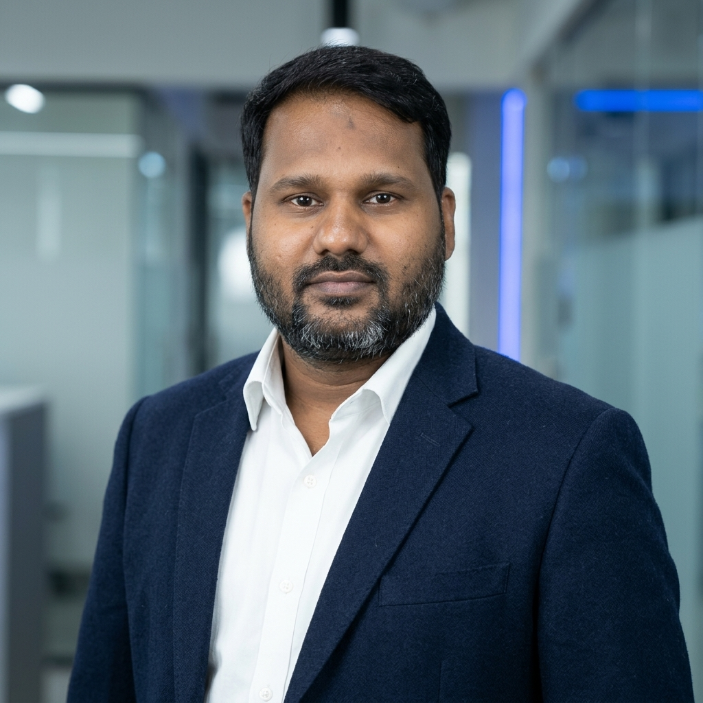

<div align="center">

<!-- Moving Wave Banner (Water-Type Header) -->


<br/>

<!-- Professional Headshot -->
<a href="https://github.com/Nutankrji">
  
</a>

<br/><br/>

<!-- Continuous Lighted / Glowing Typing Animation -->
<a href="https://github.com/Nutankrji">
  
</a>

<br/><br/>

<!-- Action & Hiring Badges (Guaranteed Working Direct URLs) -->
[](https://raw.githubusercontent.com/Nutankrji/Nutankrji/main/Nutan_Kumar_DevOps_Resume.pdf)
[](https://github.com/Nutankrji/Nutankrji/blob/main/Nutan_Kumar_DevOps_Resume.pdf)
[](https://www.linkedin.com/in/nutan-kumar-051b94102/)
[](https://www.naukri.com/mnjuser/profile)
[](mailto:nutanfromgola@gmail.com)
[](https://wa.me/917015346707)

<br/><br/>

> **"Bridging developer velocity with enterprise-grade cloud reliability, zero-downtime releases, and automated scalability."**

📍 **Noida, Uttar Pradesh, India** &nbsp;|&nbsp; 💼 **Open to Senior DevOps / Lead / Platform Engineering Roles**

---

</div>

## 📌 Executive Summary

Battle-tested **Senior DevOps & Cloud Infrastructure Engineer** with **8+ years** hands-on experience designing, provisioning, and maintaining high-availability production environments across **AWS** and **Microsoft Azure**. 

With a strong foundation starting in **enterprise Linux system administration and NOC infrastructure (dating back to 2015)**, I bring deep system-level troubleshooting knowledge combined with modern cloud-native practices:
- **Infrastructure as Code (IaC):** Modular, reproducible architectures using **Terraform**.
- **Container Orchestration:** Containerizing microservices with **Docker** and managing workloads on **Kubernetes (EKS / AKS)**.
- **Automated CI/CD:** Building resilient deployment pipelines in **Jenkins**, **Azure DevOps**, and **GitHub Actions**.
- **Production Observability:** End-to-end monitoring, centralized logging, and alerting with **Prometheus**, **Grafana**, **CloudWatch**, and **Azure Monitor**.
- **Incident & Reliability Management:** Root Cause Analysis (RCA), L2/L3 production escalations, change management, and zero-downtime releases.

---

## 🛠️ Technical Competencies & Toolchain

### ☁️ Cloud & Virtualization


### 🚀 CI/CD & Automation


### 📦 Containers & Orchestration


### 📜 Infrastructure as Code & Scripting


### 📊 Observability, Logs & Metrics


### 🖥️ Operating Systems, Web Servers & Networking


---

## 💼 Professional Experience Timeline

```
2015 ───► 2016 ───► 2018 ───► 2021 ──────────► Present
 │         │         │         │                 │
 │         │         │         │                 └─► Senior DevOps Engineer / Infra Lead (PowerHF India)
 │         │         │         └─► Cloud / Infrastructure Engineer (Kutumbh Care)
 │         │         └─► Linux Administrator (Rudra Infra Build)
 │         └─► Desktop / NOC Support Engineer (NR Switch & Radio)
 └─► Technical Support Engineer (Quess Corp)
```

### 🔹 **Senior DevOps / IT Infrastructure Engineer** — *PowerHF India Pvt. Ltd.*
*Feb 2021 – Present | Noida, India*
- Architected and managed production environments spanning **AWS** (EC2, VPC, IAM, S3, Security Groups) and **Microsoft Azure** (VMs, VNet, NSG, Storage Accounts).
- Designed and maintained end-to-end **Jenkins CI/CD pipelines** for automated build, containerization, testing, and multi-environment deployment.
- Authored reusable **Terraform modules** to enforce Infrastructure as Code (IaC) standards and eliminate manual configuration drift.
- Orchestrated containerized workloads using **Docker** and managed container deployments in **Kubernetes**.
- Configured unified monitoring dashboards via **Prometheus + Grafana** and **CloudWatch / Azure Monitor**, reducing Mean Time to Resolution (MTTR) by establishing proactive alerting thresholds.
- Authored production automation scripts in **Bash** and **Python** for log rotation, disk cleanup, automated backup routines, and service failover.

### 🔹 **Cloud / Infrastructure Engineer** — *Kutumbh Care Pvt. Ltd.*
*Dec 2018 – Feb 2021 | Jaipur, Rajasthan*
- Managed Azure enterprise infrastructure across Dev, Test, and Production environments.
- Automated resource lifecycle operations (VM provisioning, VNets, Subnets, NSGs, Azure Load Balancers) using **Terraform**.
- Managed **Microsoft Entra ID (Azure AD)**, implemented Role-Based Access Control (**RBAC**), and reinforced cloud identity security.
- Monitored cluster metrics and server health using **Azure Monitor** and **Log Analytics workspaces**.

### 🔹 **Linux Administrator / Support Engineer** — *Rudra Infra Build Pvt. Ltd.*
*Feb 2018 – Dec 2018 | Dehradun, Uttarakhand*
- Administered Debian/Ubuntu and CentOS servers; handled kernel parameters, file systems, disk partitioning (LVM), and user permission policies.
- Configured and tuned **Nginx** and **Apache** reverse proxies, SSL/TLS certificates, and firewall policies.

### 🔹 **Desktop / NOC Support Engineer** — *NR Switch & Radio Services*
*Jul 2016 – Feb 2018 | Ludhiana, Punjab*
- 24/7 Network Operations Center (NOC) monitoring, incident triage, and L1/L2 escalation handling.

### 🔹 **Technical Support Engineer** — *Quess Corp Limited*
*Oct 2015 – Jul 2016 | Delhi & Punjab*
- Network diagnostics, hardware/system troubleshooting, rollout checklists, and technical documentation.

---

## 🏗️ Core Engineering Practices & Highlights

| Area | Production Highlights |
| :--- | :--- |
| **Zero-Downtime Releases** | Blue/Green & Rolling deployment strategies via CI/CD pipelines and reverse proxy traffic shifting. |
| **Infrastructure as Code** | State management, remote backends (S3/Azure Blob with DynamoDB state locking), and modular Terraform architecture. |
| **Security & Compliance** | Least-privilege IAM policies, VPC/VNet segregation, private subnets, bastion hosts, and secret management. |
| **Site Reliability** | 99.9%+ uptime tracking, automated health checks, self-healing containers, and incident post-mortems. |

---

## 📊 GitHub Analytics

<div align="center">
  
  
</div>

<div align="center">
  
</div>

---

## 🎓 Education & Certifications

- **B.Tech in Electronics & Communication Engineering (A Grade)** — *Anand Engineering College, Agra (UPTU)*
- **DevOps Fundamentals Certification**
- **Gilbarco Automation Certification**
- **Embedded Systems (CETPA)**
- **Best Quality Award** — *Quess Corp*

---

## 📬 Direct Contact & Profiles

I am always open to discussing cloud architecture, DevOps automation pipelines, SRE challenges, or exploring senior engineering leadership opportunities.

- 📥 **Download CV (Direct PDF):** [Download Official Resume](https://raw.githubusercontent.com/Nutankrji/Nutankrji/main/Nutan_Kumar_DevOps_Resume.pdf)
- 👁️ **Preview CV on GitHub:** [View PDF on GitHub](https://github.com/Nutankrji/Nutankrji/blob/main/Nutan_Kumar_DevOps_Resume.pdf)
- 💼 **LinkedIn Profile:** [Nutan Kumar on LinkedIn](https://www.linkedin.com/in/nutan-kumar-051b94102/)
- 🌐 **Naukri.com Profile:** [Candidate Profile on Naukri](https://www.naukri.com/mnjuser/profile)
- 📧 **Direct Email:** [nutanfromgola@gmail.com](mailto:nutanfromgola@gmail.com)
- 📱 **Call / WhatsApp:** [+91-7015346707](https://wa.me/917015346707)

<br/>

<!-- Moving Wave Banner (Water-Type Footer) -->
<div align="center">
  
</div>
